<p align="center">
  
</p>

<h1 align="center">ConfereAí</h1>
<p align="center"><b>Confira antes de pagar.</b><br>
Aplicativo que ajuda pessoas idosas a identificarem golpes financeiros antes de fazer um pagamento.</p>

---

## 👥 Desenvolvedores

| RM | Nome completo |
|----|---------------|
| RM558820 | Geisa Rodrigues Santos |
| RM558937 | Matheus Soares Pereira |

## 🎥 Vídeo pitch

[Link do vídeo pitch](https://youtube.com/@matheussoaresae?si=N6MIN04S4kC6zixI)

---

## 🌎 Tema da Global Solution: CitizenTech

A Global Solution 2026 propõe **tecnologias criadas a partir das necessidades reais das pessoas**, colocando o cidadão no centro da inovação. Entre as frentes sugeridas estão o **apoio a idosos**, os **assistentes digitais para serviços** e a **redução das desigualdades**.

### O problema

A população idosa está cada vez mais conectada e virou o alvo preferido dos golpistas:

- **82%** dos idosos do estado de São Paulo já sofreram tentativas de golpes virtuais (Fundação Seade, pesquisa SP TIC 2025).
- Pessoas com mais de 60 anos têm a **maior proporção de vítimas (12%) em fraudes graves**, como empréstimos e contas bancárias abertas sem autorização.
- **68%** dos idosos acham que hoje é **praticamente impossível se proteger** de golpes on-line.

Os golpistas se passam por bancos, lojas e até parentes, usam a **pressa** e o **medo** e pedem pagamentos por boleto ou Pix.

### A solução

O **ConfereAí** cria o hábito de **conferir antes de agir**. Antes de pagar um boleto ou Pix, o idoso:

1. **Confere quem está cobrando**: digita o CNPJ, e o app consulta a **Receita Federal** (via BrasilAPI) para mostrar se a empresa existe, se está ativa, há quanto tempo foi aberta e se o nome bate com o que disseram.
2. **Faz o teste do golpe**: responde perguntas simples de "Sim" ou "Não" sobre a conversa (pediram código? disseram que é urgente? parente com número novo?).
3. **Vê o resultado em um semáforo** 🟢🟡🔴, com a explicação de cada sinal de alerta em linguagem simples.
4. **Liga para uma pessoa de confiança** com um único toque, antes de tomar qualquer decisão.

Também é possível **conferir o banco do boleto** (os 3 primeiros números da linha digitável) na lista oficial do Banco Central.

### ODS relacionados

| ODS | Como o ConfereAí contribui |
|-----|----------------------------|
| **ODS 10**: Redução das desigualdades | Inclusão digital segura da pessoa idosa, que ganha autonomia para usar serviços digitais sem depender de terceiros. |
| **ODS 11**: Cidades e comunidades sustentáveis | Fortalece a rede de proteção comunitária (família e pessoas de confiança) contra crimes digitais. |
| **ODS 3**: Saúde e bem-estar | Reduz a ansiedade e o medo de usar o celular, além de evitar perdas financeiras que afetam a saúde emocional. |

### Acessibilidade pensada para idosos

- Letras grandes, botões altos (mínimo de 60 px) e alto contraste.
- Botão na tela inicial para **aumentar o tamanho das letras** em todo o app (salvo no aparelho).
- Textos curtos, sem termos técnicos, e respostas por cores (semáforo).
- Uma ação por tela e confirmação com ícones.

---

## 📱 Fluxo de telas

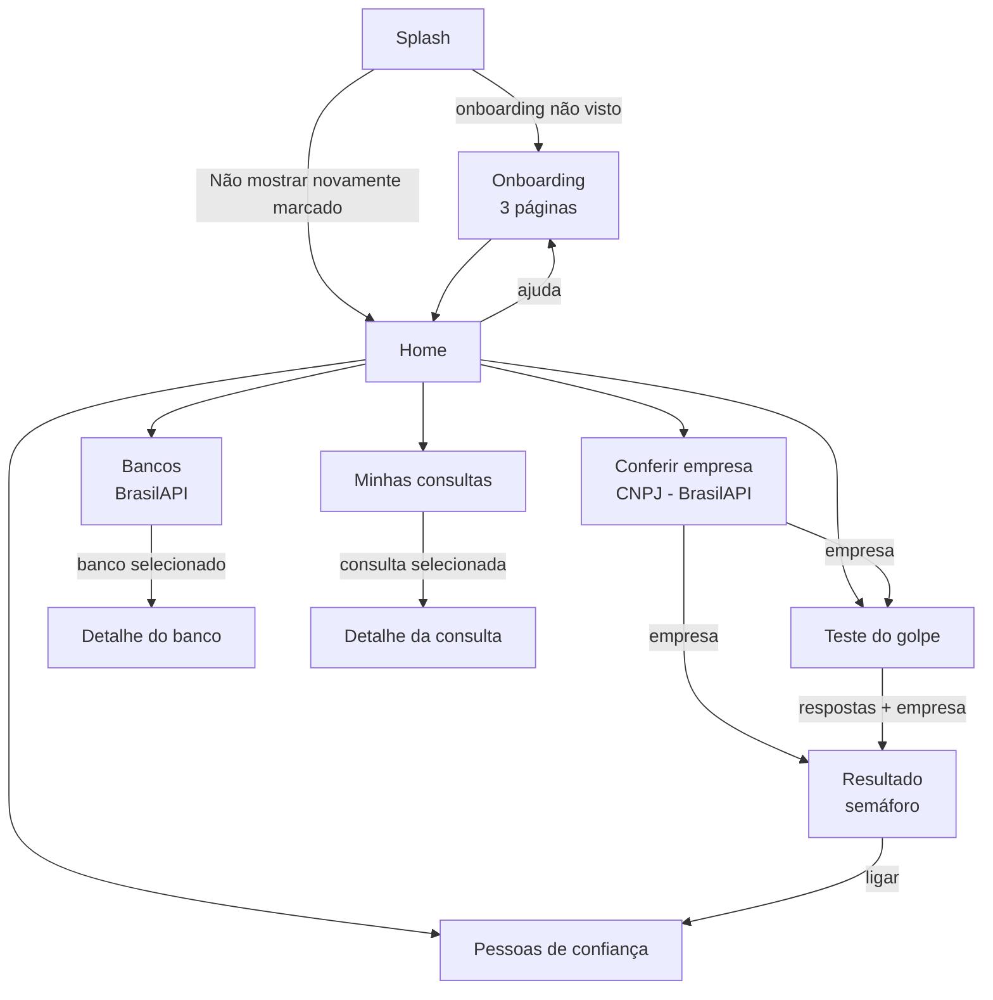

| # | Tela | O que faz |
|---|------|-----------|
| 1 | **Splash** | Mostra o logo e verifica no `SharedPreferences` se a introdução já foi vista. |
| 2 | **Onboarding** | 3 páginas com imagem, título e descrição, botões Voltar/Avançar, opção "Não mostrar novamente". |
| 3 | **Home** | Menu principal com cartões grandes e o botão "Ligar para minha pessoa de confiança". |
| 4 | **Conferir empresa** | Formulário de CNPJ com máscara e validação, consulta à API com os estados inicial, carregando, sucesso e erro. |
| 5 | **Teste do golpe** | 8 perguntas de Sim/Não. Os cartões mudam de cor conforme a resposta. |
| 6 | **Resultado** | Semáforo de risco, motivos, dados da empresa, marcar como confiável e ligar. |
| 7 | **Bancos** | Lista de bancos da API com busca por nome ou pelos números do boleto. |
| 8 | **Detalhe do banco** | Código, nome completo, ISPB e como conferir o boleto. |
| 9 | **Minhas consultas** | Histórico com filtros (Perigo, Atenção, Seguras, Confiáveis) e favoritos ⭐. |
| 10 | **Detalhe da consulta** | Sinais encontrados, marcar como confiável e apagar. |
| 11 | **Pessoas de confiança** | Cadastrar, remover, definir o contato principal e ligar. |

## 🖼️ Prints das telas


| Splash | Onboarding | Home | Conferir empresa |
|---|---|---|---|
| 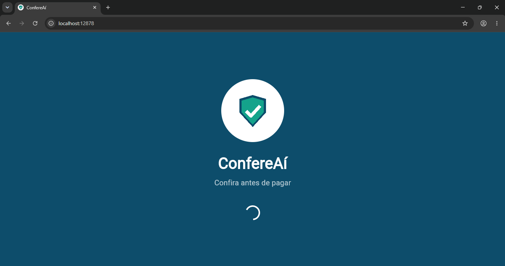 | 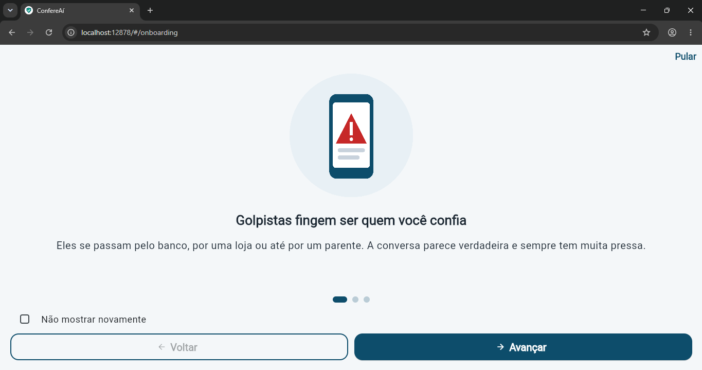 | 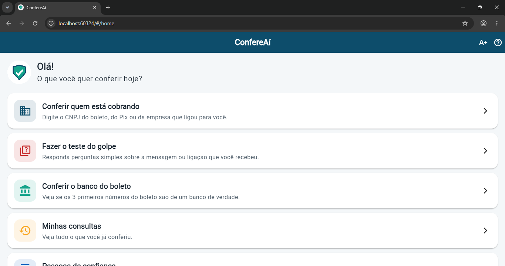 | 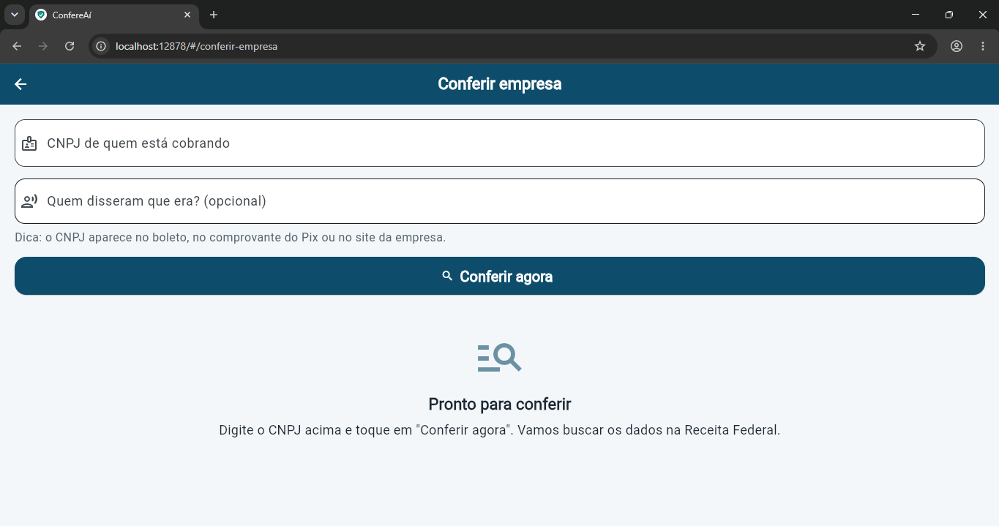 |

| Teste do golpe | Resultado | Bancos | Histórico |
|---|---|---|---|
| 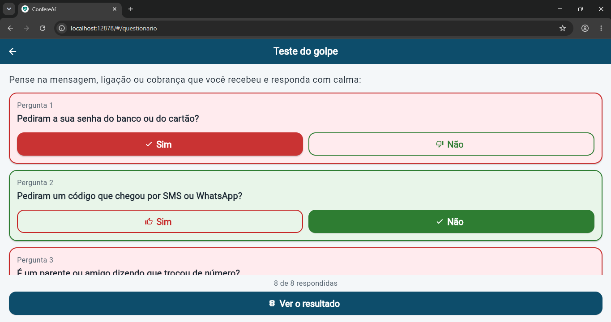 | 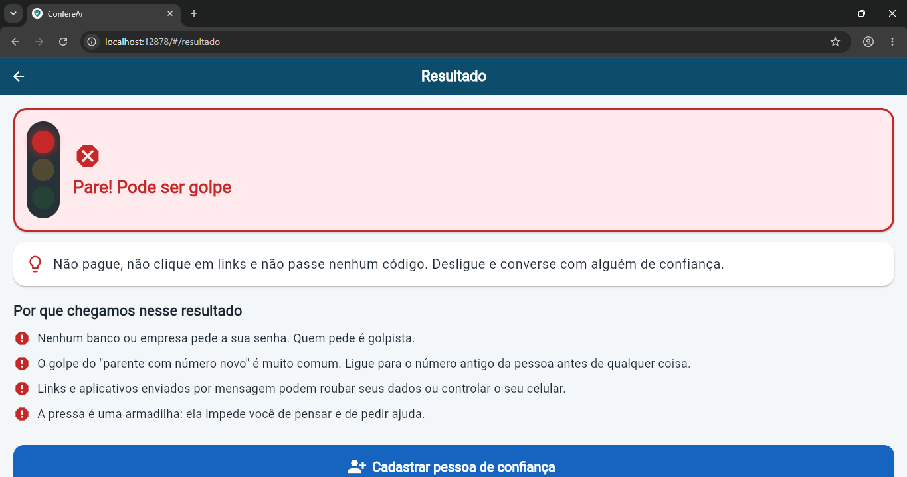 | 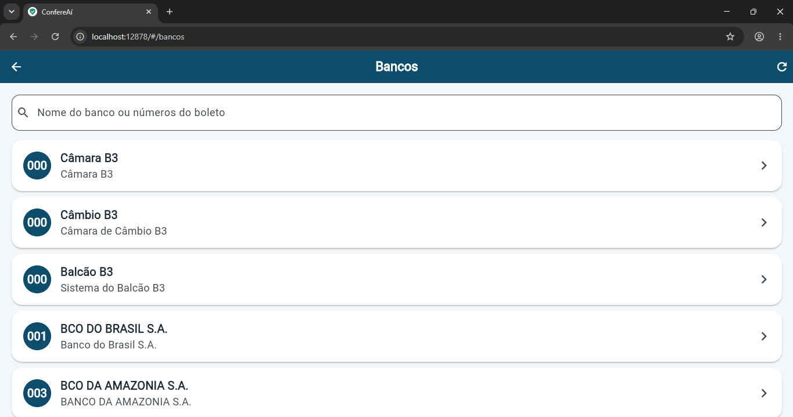 | 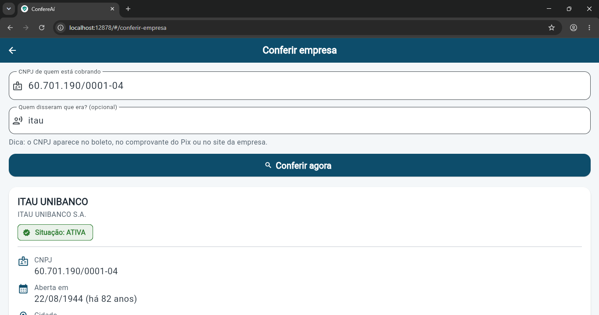 |

| Detalhe do banco | Detalhe da consulta | Pessoas de confiança | Estado de erro |
|---|---|---|---|
| 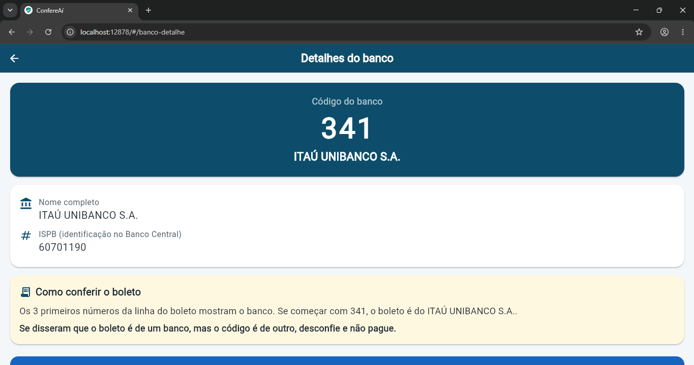 | 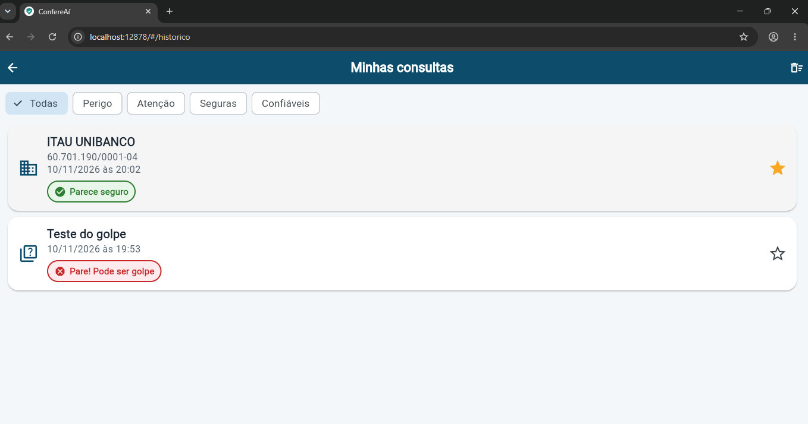 | 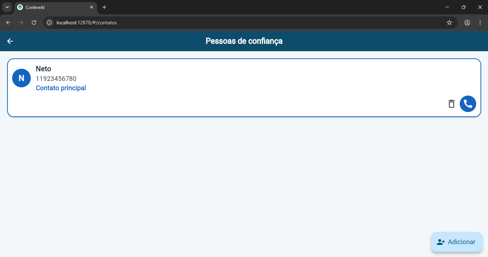 | 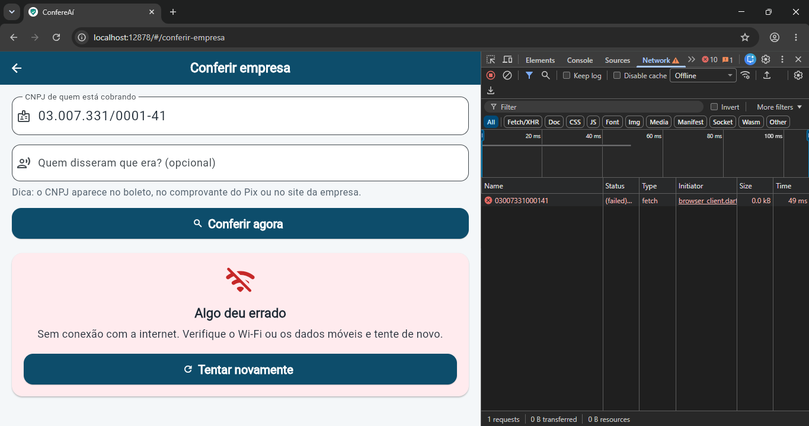 |

---

## 🔌 API utilizada

**[BrasilAPI](https://brasilapi.com.br)** é uma API REST pública, gratuita e sem necessidade de chave, que reúne dados oficiais do governo brasileiro.

| Endpoint | Uso no app | Fonte oficial |
|----------|-----------|---------------|
| `GET https://brasilapi.com.br/api/cnpj/v1/{cnpj}` | Dados cadastrais da empresa (razão social, situação, data de abertura, cidade, atividade) | Receita Federal |
| `GET https://brasilapi.com.br/api/banks/v1` | Lista de bancos com código de compensação (o mesmo código do boleto) | Banco Central |

Exemplo de resposta (resumida) do CNPJ:

```json
{
  "cnpj": "19131243000197",
  "razao_social": "OPEN KNOWLEDGE BRASIL",
  "nome_fantasia": "REDE PELO CONHECIMENTO LIVRE",
  "descricao_situacao_cadastral": "ATIVA",
  "data_inicio_atividade": "2013-10-03",
  "municipio": "SAO PAULO",
  "uf": "SP",
  "cnae_fiscal_descricao": "Atividades de associações de defesa de direitos sociais"
}
```

O JSON é convertido em objetos Dart (`Empresa.fromJson`, `Banco.fromJson`). Os erros HTTP (404, 400, 429, 5xx, sem internet e tempo esgotado) viram mensagens amigáveis (`ApiException`), exibidas com o botão **"Tentar novamente"**.

> 💡 O app já valida o **novo CNPJ alfanumérico** da Receita Federal (com letras nas 12 primeiras posições), que passou a valer em julho de 2026.

**CNPJs para testar:**

| CNPJ | Esperado |
|------|----------|
| `00.000.000/0001-91` | Banco do Brasil: ativa e antiga (🟢) |
| `19.131.243/0001-97` | Open Knowledge Brasil: ativa (🟢) |
| `00.000.000/0001-91` + nome "Nubank" | Nome não bate (🟡) |
| Qualquer CNPJ + responder "Sim" para "Pediram a sua senha?" | 🔴 |

---

## 🏗️ Arquitetura

O projeto separa **interface**, **modelos**, **regras de negócio**, **serviços** e **acesso aos dados**. Nenhuma regra de negócio fica dentro dos widgets das telas.

```
lib/
├── main.dart                     # runApp
├── app.dart                      # MaterialApp, tema, rotas e tamanho da letra
├── core/                         # Configurações compartilhadas
│   ├── app_cores.dart
│   ├── app_tema.dart
│   ├── app_rotas.dart            # Rotas nomeadas + passagem de parâmetros
│   ├── formatadores.dart
│   └── nivel_risco_visual.dart   # Cor e ícone de cada nível
├── models/                       # Objetos de domínio (fromJson / toJson)
│   ├── empresa.dart  banco.dart  consulta.dart  contato_confianca.dart
│   ├── avaliacao.dart  nivel_risco.dart  pergunta_golpe.dart
│   ├── estado_requisicao.dart    # inicial | carregando | sucesso | erro
│   └── argumentos.dart  pagina_onboarding.dart
├── regras/                       # Regras de negócio puras (100% testáveis)
│   ├── validador_cnpj.dart       # Dígitos verificadores (numérico e alfanumérico)
│   ├── texto_util.dart           # Comparação de nomes sem acento
│   ├── filtros.dart              # Busca de bancos e filtro do histórico
│   ├── avaliador_risco.dart      # Soma os sinais e classifica no semáforo
│   └── regras_risco/             # Strategy Pattern
│       ├── regra_risco.dart              (interface)
│       ├── regra_situacao_cadastral.dart (empresa não ativa: +100)
│       ├── regra_empresa_recente.dart    (< 6 meses: +40 | < 1 ano: +20)
│       ├── regra_nome_divergente.dart    (nome não bate: +35)
│       └── regra_perguntas_golpe.dart    (cada "Sim" soma pontos)
├── services/                     # Comunicação externa
│   ├── brasil_api_service.dart   # http + tratamento de erros
│   ├── api_exception.dart
│   └── ligacao_service.dart      # Abre o discador (url_launcher)
├── repositories/                 # Persistência local (SharedPreferences)
│   ├── preferencias_repository.dart  # onboarding e tamanho da letra
│   ├── historico_repository.dart     # consultas em JSON
│   └── contatos_repository.dart      # pessoas de confiança em JSON
├── screens/                      # 11 telas (StatefulWidget/StatelessWidget + setState)
└── widgets/                      # Widgets reutilizáveis
    ├── card_opcao.dart  card_empresa.dart  card_pergunta.dart  card_consulta.dart
    ├── semaforo_risco.dart  estados.dart  linha_info.dart  pagina_onboarding.dart
    ├── botao_ligar_contato.dart  logo_confereai.dart  cnpj_input_formatter.dart
```

### Decisões de projeto

- **Strategy Pattern nas regras de risco**: cada sinal de golpe é uma classe que implementa `RegraRisco`. Para criar uma regra nova, basta adicionar uma classe ao `AvaliadorRisco.padrao()`, sem mexer nas outras (o mesmo princípio do Simulador de Frete visto em aula).
- **Injeção de dependência**: `BrasilApiService` recebe o `http.Client` pelo construtor e as telas recebem services e repositórios opcionais. Nos testes usamos um `MockClient` (fake), como no exemplo do Jokenpô.
- **Gerenciamento de estado com `setState`**: o enum `EstadoRequisicao` controla a interface de cada requisição (inicial, carregando, sucesso, erro).
- **Segurança do usuário**: quando o risco é alto, o app **não** oferece "Marcar como confiável".

### Requisitos do enunciado × implementação

| Requisito | Onde está |
|-----------|-----------|
| 1. Splash + SharedPreferences | `screens/splash_screen.dart`, `repositories/preferencias_repository.dart` |
| 2. Onboarding com 3 páginas, Voltar/Avançar e "Não mostrar novamente" | `screens/onboarding_screen.dart`, `widgets/pagina_onboarding.dart` |
| 3. Navegação (11 telas), parâmetros e retorno | `core/app_rotas.dart` (`onGenerateRoute` com `arguments`) |
| 4. WebService (`http`, models, 4 estados, tentar novamente) | `services/brasil_api_service.dart`, `screens/conferir_empresa_screen.dart`, `screens/bancos_screen.dart` |
| 5. Column, Row, Card, ListView, Scaffold, AppBar, botões, Icon/IconButton, Image.asset | Todas as telas, com `Image.asset` no logo e no onboarding |
| 6. Interações (lista → detalhe, busca, filtro, favoritar, atualizar, mudança visual) | Bancos → Detalhe, Histórico → Detalhe, busca de bancos, filtros por risco, ⭐ confiável, pull-to-refresh, cartões do teste mudam de cor |
| 7. Organização, StatelessWidget/StatefulWidget, setState e separação de camadas | Estrutura de pastas acima |

---

## ▶️ Como executar

Pré-requisito: Flutter com Dart 3.11.5 ou superior (mesma versão usada para criar o projeto).

```bash
flutter pub get
flutter run
```

### Testes

O projeto tem testes unitários (regras, models, service com cliente HTTP falso, repositórios) e testes de widget, organizados com `group`, `setUp` e o padrão Arrange, Act e Assert.

```bash
flutter test
```

---

## 📚 Fontes do problema

- Fundação Seade, *SP TIC*, 2025: [Golpes virtuais atingem 82% dos idosos em São Paulo](https://abcdoabc.com.br/golpes-virtuais-82-dos-idosos-em-sao-paulo/)
- [Oito a cada 10 idosos sofreram tentativas de golpes virtuais em SP (Viva)](https://viva.com.br/tecnologia/oito-a-cada-10-idosos-sofreram-tentativas-de-golpes-virtuais-em-sp.html)
- [FIAP Global Solution: CitizenTech](https://experience.fiap.com.br/global-solution-citizen-tech)
